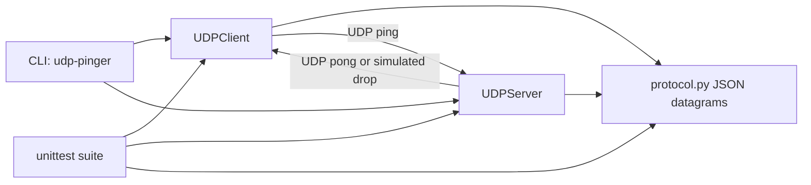

# UDP Pinger

UDP Pinger is a small, production-minded Python project for measuring UDP round-trip latency and simulating packet loss. It started as a socket-programming assignment and has been upgraded into an importable package with a clean CLI, deterministic tests, robust validation, and compatibility wrappers for the original assignment scripts.

## What It Does

| Capability | Description |
| --- | --- |
| UDP ping client | Sends numbered UDP ping datagrams and reports per-packet RTT. |
| UDP ping server | Receives ping datagrams and replies with matching pong datagrams. |
| Packet-loss simulation | Server can intentionally drop a configurable percentage of valid packets. |
| Heartbeat mode | Client sends repeated heartbeats and declares the server unavailable after consecutive losses. |
| Metrics summary | Client reports sent, received, lost, loss percentage, and min/avg/max RTT. |
| Compatibility scripts | Original `part1_*` and `part2_*` files still run, but delegate to the maintained package. |

## Repository Layout

```text
.
├── Assignment1_UDP_Pinger/
│   ├── Description.pdf
│   ├── Presentation.pptx
│   ├── part1_client.py
│   ├── part1_server.py
│   ├── part2_client.py
│   └── part2_server.py
├── tests/
│   ├── test_client.py
│   ├── test_protocol.py
│   └── test_server.py
├── udp_pinger/
│   ├── cli.py
│   ├── client.py
│   ├── protocol.py
│   └── server.py
├── pyproject.toml
├── requirements.txt
└── UDP_Pinger.zip
```

The PDF, PowerPoint, and original zip are preserved as assignment artifacts. The maintained implementation lives in `udp_pinger/`.

## Architecture



### Execution Flow

1. The client builds a `PingMessage` containing a sequence number, monotonic timestamp, and optional payload.
2. `protocol.py` serializes the message to compact UTF-8 JSON and enforces a conservative UDP datagram size.
3. The server validates incoming datagrams, counts malformed packets, optionally simulates packet loss, and sends a matching `PongMessage`.
4. The client ignores stale or mismatched responses, records RTT from monotonic time, and summarizes packet-loss metrics.
5. Heartbeat mode repeats the same ping flow until a configured number of consecutive packets are lost.

## Requirements

| Requirement | Version |
| --- | --- |
| Python | 3.9 or newer |
| Runtime packages | None outside the standard library |
| Test runner | `unittest`, included with Python |

On macOS, use `python3` if `python` is not available.

## Setup

Create and activate a virtual environment:

```bash
python3 -m venv .venv
source .venv/bin/activate
```

Install the project:

```bash
python3 -m pip install .
```

No third-party runtime dependencies are required. `requirements.txt` is intentionally empty except for a note.

For active development with a modern pip, editable installs are also supported:

```bash
python3 -m pip install --upgrade pip
python3 -m pip install -e .
```

## Usage

Open two terminals from the repository root.

### Start A Server

```bash
python3 -m udp_pinger server --host 127.0.0.1 --port 12000 --loss-rate 0.25
```

`--loss-rate` is a decimal from `0.0` to `1.0`. For example, `0.25` drops roughly 25 percent of valid packets.

### Send Pings

```bash
python3 -m udp_pinger client --host 127.0.0.1 --port 12000 --count 10 --timeout 1 --interval 1
```

Example output:

```text
Pinging 127.0.0.1:12000 with 10 UDP datagram(s), timeout 1.000s
seq=1 rtt=0.481 ms
seq=2 lost (request timed out)

Summary: sent=10 received=8 lost=2 loss=20.0%
RTT: min=0.212 ms avg=0.390 ms max=0.801 ms
```

### Run Heartbeats

```bash
python3 -m udp_pinger heartbeat --host 127.0.0.1 --port 12000 --max-consecutive-losses 3
```

Heartbeat mode exits with status `2` when the last observed state is unavailable.

### Installable CLI

After `python3 -m pip install .`, the console script is also available:

```bash
udp-pinger --help
udp-pinger server --loss-rate 0.1
udp-pinger client --count 5 --interval 0.2
```

### Original Assignment Scripts

The original script names still work:

```bash
python3 Assignment1_UDP_Pinger/part1_server.py
python3 Assignment1_UDP_Pinger/part1_client.py
python3 Assignment1_UDP_Pinger/part2_server.py
python3 Assignment1_UDP_Pinger/part2_client.py
```

They now call the maintained CLI instead of carrying duplicated socket logic.

## Command Reference

### `client`

| Option | Default | Description |
| --- | --- | --- |
| `--host` | `127.0.0.1` | Server host or IP address. |
| `--port` | `12000` | Server UDP port. |
| `--count` | `10` | Number of datagrams to send. |
| `--timeout` | `1.0` | Seconds to wait for each response. |
| `--interval` | `1.0` | Seconds between pings. |
| `--payload` | empty | Optional payload echoed by the server. |

### `heartbeat`

| Option | Default | Description |
| --- | --- | --- |
| `--host` | `127.0.0.1` | Server host or IP address. |
| `--port` | `12000` | Server UDP port. |
| `--timeout` | `1.0` | Seconds to wait for each heartbeat. |
| `--interval` | `1.0` | Seconds between heartbeats. |
| `--payload` | `heartbeat` | Optional payload echoed by the server. |
| `--max-consecutive-losses` | `3` | Consecutive misses required to declare unavailable. |
| `--max-pings` | unset | Optional cap for demos and automation. |

### `server`

| Option | Default | Description |
| --- | --- | --- |
| `--host` | `127.0.0.1` | Interface to bind. |
| `--port` | `12000` | UDP port to bind. Use `0` in code to request an ephemeral test port. |
| `--loss-rate` | `0.0` | Simulated packet loss rate from `0.0` to `1.0`. |
| `--max-packets` | unset | Stop after this many packets, useful for demos and tests. |

## Testing

Run the full test suite:

```bash
python3 -m unittest discover -v
```

Current coverage focuses on:

| Area | Covered Behavior |
| --- | --- |
| Protocol | JSON round trips, wrong message kind rejection, oversized datagram rejection. |
| Client | Configuration validation, mixed-result summaries, empty summaries, heartbeat validation. |
| Server | Real local UDP round trip, simulated packet drops, malformed datagrams, heartbeat loss behavior. |

Syntax-check the package and scripts:

```bash
python3 -m compileall udp_pinger Assignment1_UDP_Pinger tests
```

## Implementation Details

| Concern | Decision |
| --- | --- |
| Timing | RTT uses `time.monotonic_ns()` so system clock changes do not corrupt measurements. |
| Wire format | Compact JSON keeps datagrams inspectable and avoids brittle comma-splitting. |
| Datagram size | Messages are capped at 1400 bytes to stay below common Ethernet MTU limits. |
| Defaults | Client and server default to `127.0.0.1`, avoiding unreliable hostname-to-LAN-IP behavior. |
| Errors | Expected network failures return structured `PingResult` values instead of broad exception swallowing. |
| Dependencies | Removed undeclared `dateutil`; the project now uses only the Python standard library. |
| Testability | Server supports `max_packets`, ephemeral ports, readiness events, and injectable randomness. |

## Troubleshooting

| Symptom | Likely Cause | Fix |
| --- | --- | --- |
| `python: command not found` | macOS often exposes Python as `python3`. | Use `python3 ...`. |
| Client reports every packet lost | Server is not running, host/port mismatch, firewall, or 100% loss rate. | Start the server and verify `--host`, `--port`, and `--loss-rate`. |
| `Address already in use` | Another process is bound to the same UDP port. | Pick another port, for example `--port 12001`. |
| No packet loss observed | UDP loss simulation is probabilistic. | Increase `--count` or use a higher `--loss-rate`. |
| Editable install fails | Old Python, disabled user site-packages, protected system Python, or stale packaging tools. | Use a virtual environment and Python 3.9+, then upgrade pip with `python3 -m pip install --upgrade pip`. |

## Changelog Of Production Improvements

| Category | Improvement |
| --- | --- |
| Correctness | Replaced wall-clock RTT calculation with monotonic timing. |
| Correctness | Added sequence/timestamp matching so stale UDP responses are ignored. |
| Reliability | Replaced broad bare `except` blocks with explicit timeout, socket, and protocol handling. |
| Reliability | Added malformed-packet accounting on the server. |
| Security | Added input validation for ports, host values, packet counts, timeouts, payload size, and loss rates. |
| Maintainability | Consolidated duplicated scripts into one package implementation. |
| Maintainability | Added dataclasses for protocol messages, results, summaries, and server stats. |
| Developer experience | Added `pyproject.toml`, importable modules, `python3 -m udp_pinger`, and console script support. |
| Testability | Added deterministic unit/integration tests with local UDP sockets and ephemeral ports. |
| Documentation | Rewrote this README with setup, architecture, usage, command reference, tests, and troubleshooting. |

## Residual Risks

UDP is connectionless and unreliable by design. This project measures and simulates that behavior; it does not provide delivery guarantees, authentication, encryption, NAT traversal, or production observability integrations. For internet-facing deployments, place this behind appropriate network controls and add authentication or message signing before trusting responses.
